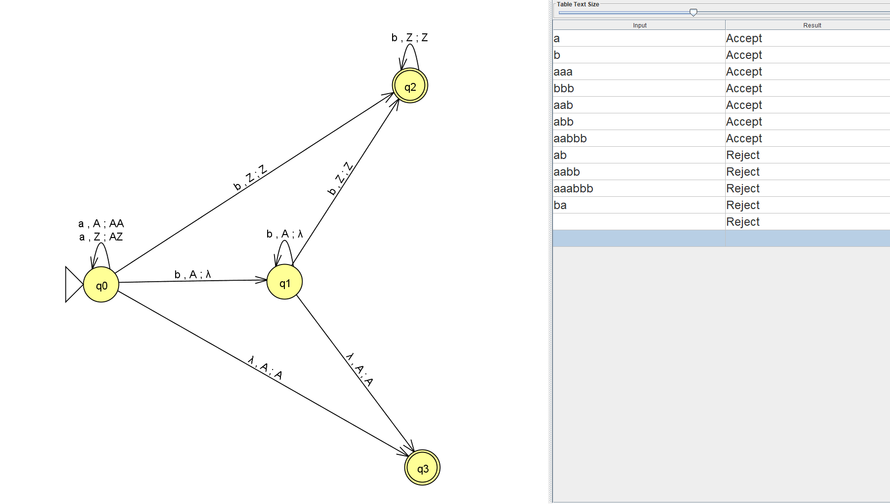

# 3. Граф переходов полученного МПА

Для языка

```math
L_{12}=\{a^n b^m\mid n\geq 0,\ n\neq m\}
```

построен автомат с магазинной памятью.

**Критерий принятия цепочек: по финальному состоянию.**

## Логика работы автомата

Состояние `q0` используется для чтения символов `a`. При чтении каждого символа `a` в магазин помещается символ `A`.

После появления первого символа `b` автомат переходит к обработке символов `b`. При чтении каждого `b`, пока в магазине есть символы `A`, один символ `A` извлекается из магазина.

Если символы `b` закончились, а в магазине остались символы `A`, количество `a` превышает количество `b`. Такая цепочка принимается.

Если в магазине больше нет символов `A`, но входная цепочка содержит дополнительные символы `b`, количество `b` превышает количество `a`. Автомат переходит в состояние `q2`, которое является финальным.

Цепочки, в которых количество `a` равно количеству `b`, не принимаются. Также не принимаются цепочки, в которых символ `a` встречается после символа `b`, поскольку они не соответствуют виду `a^n b^m`.

## Граф МПА



## Файлы

- [`pda.jff`](./pda.jff) — автомат в формате JFLAP.
- [`part1_pda.py`](./part1_pda.py) — программная реализация распознавания языка.

## Программная реализация

В программе используется стек. При чтении каждого символа `a` в стек помещается `A`, а при чтении каждого символа `b` один `A` извлекается из стека, если он есть.

Если символов `A` осталось больше нуля или встретились лишние символы `b`, количества `a` и `b` не равны, поэтому цепочка принимается. Дополнительно проверяется, что вход состоит только из символов `a` и `b` и все символы `a` расположены перед символами `b`.

## Проверка работы программы

| Цепочка | Результат | Обоснование |
|---|---|---|
| `a` | Accept | Одна `a`, символов `b` нет |
| `b` | Accept | Одна `b`, символов `a` нет |
| `aaa` | Accept | Количество `a` больше |
| `bbb` | Accept | Количество `b` больше |
| `aab` | Accept | Две `a` и одна `b` |
| `abb` | Accept | Одна `a` и две `b` |
| `aabbb` | Accept | Количество `b` больше |
| `ab` | Reject | Количества равны |
| `aabb` | Reject | Количества равны |
| `aaabbb` | Reject | Количества равны |
| `ba` | Reject | Нарушен порядок символов |
| Пустая цепочка | Reject | Количества равны нулю |
