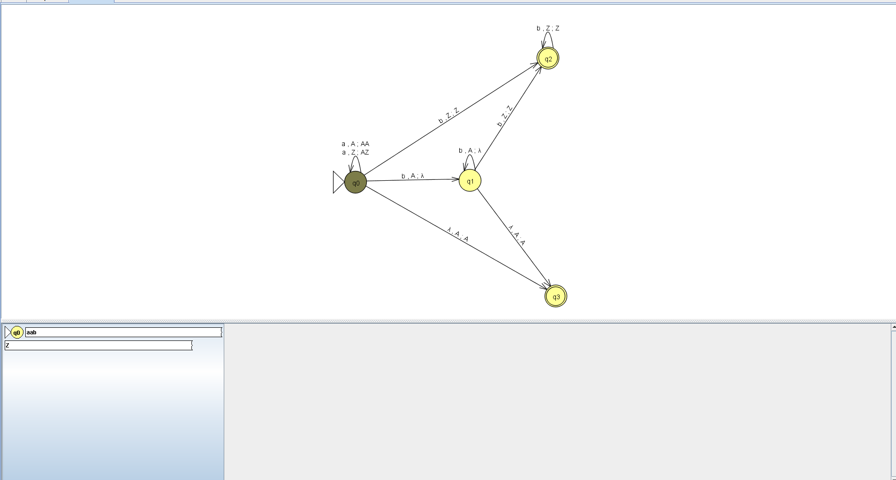
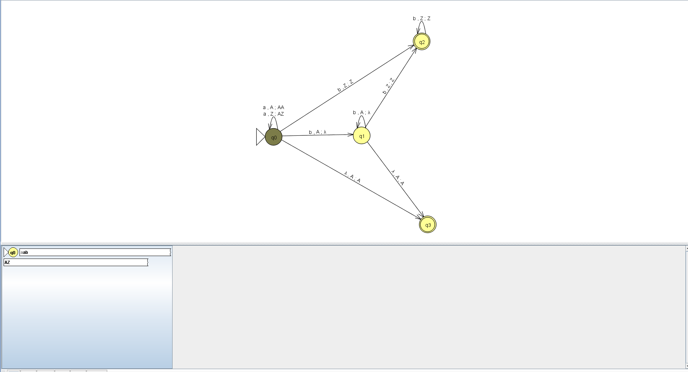
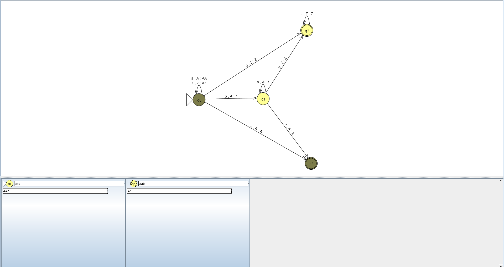
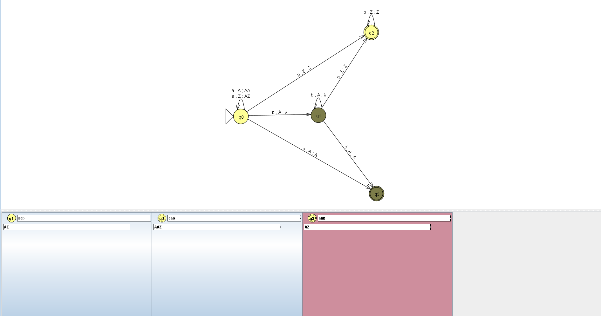
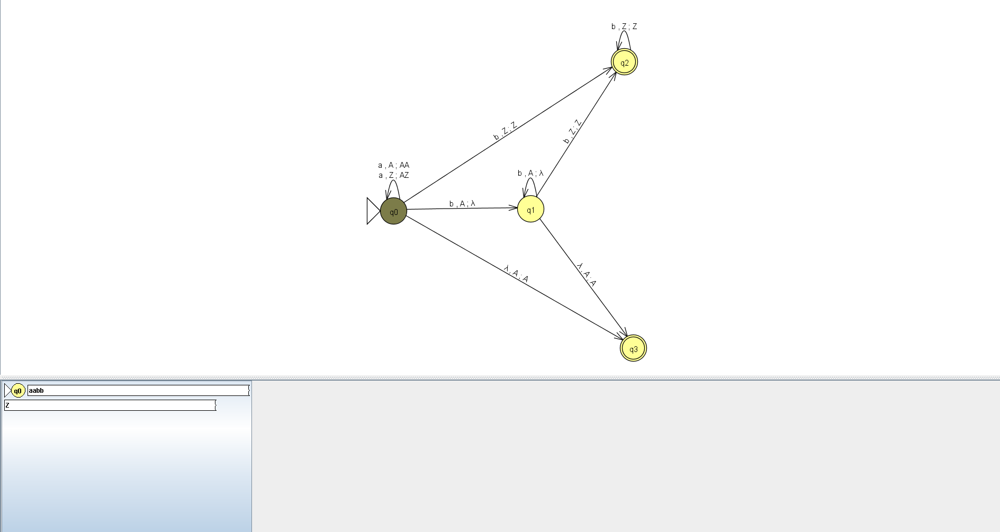
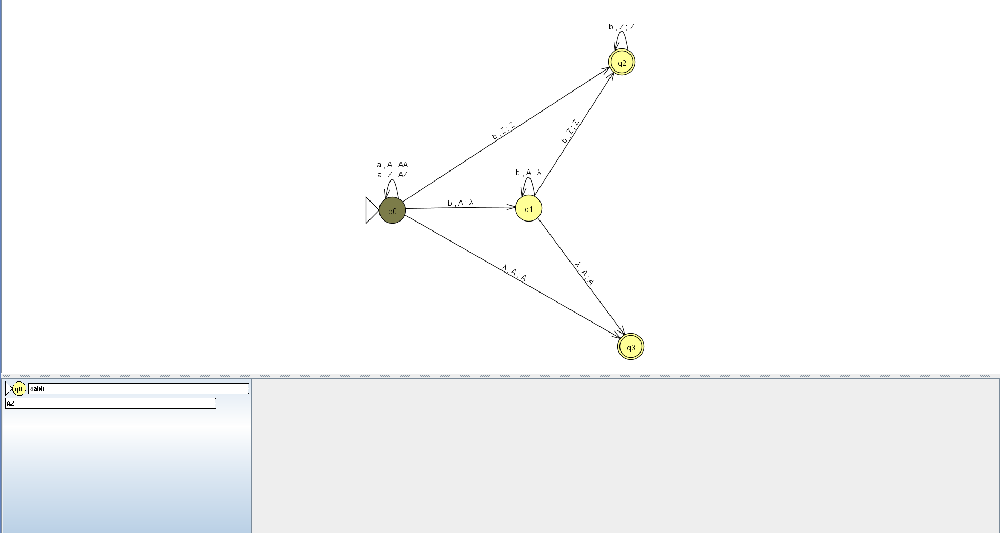
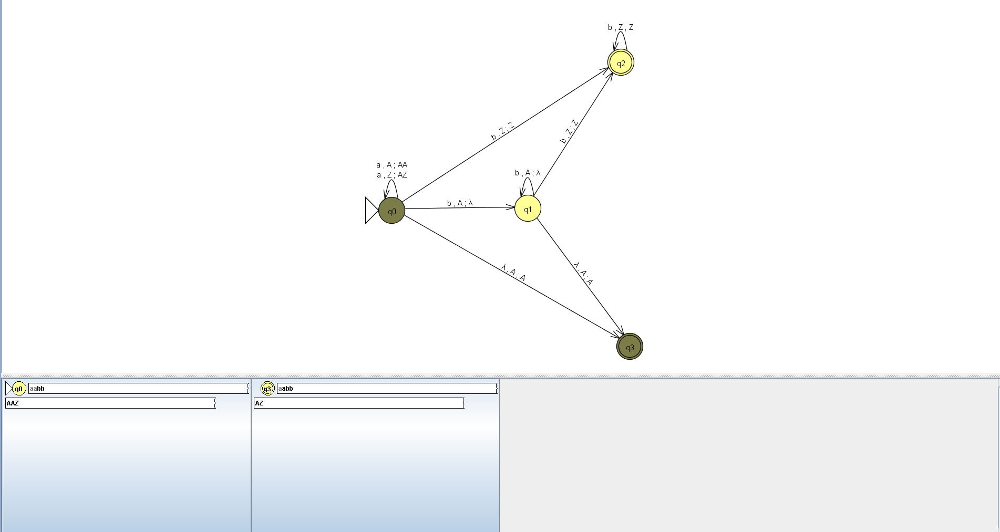
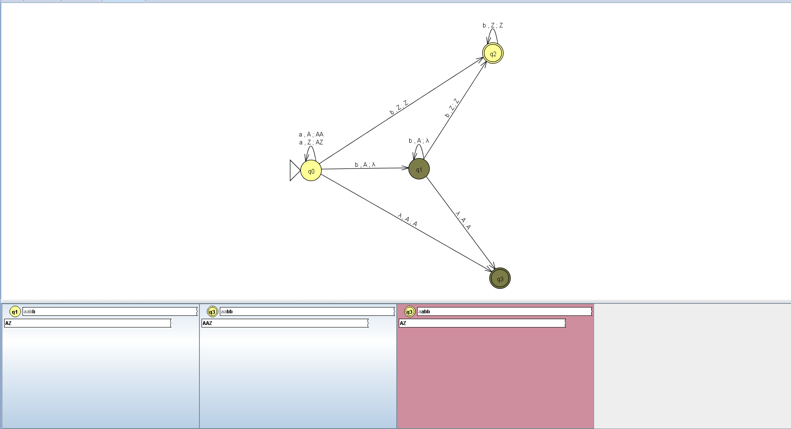
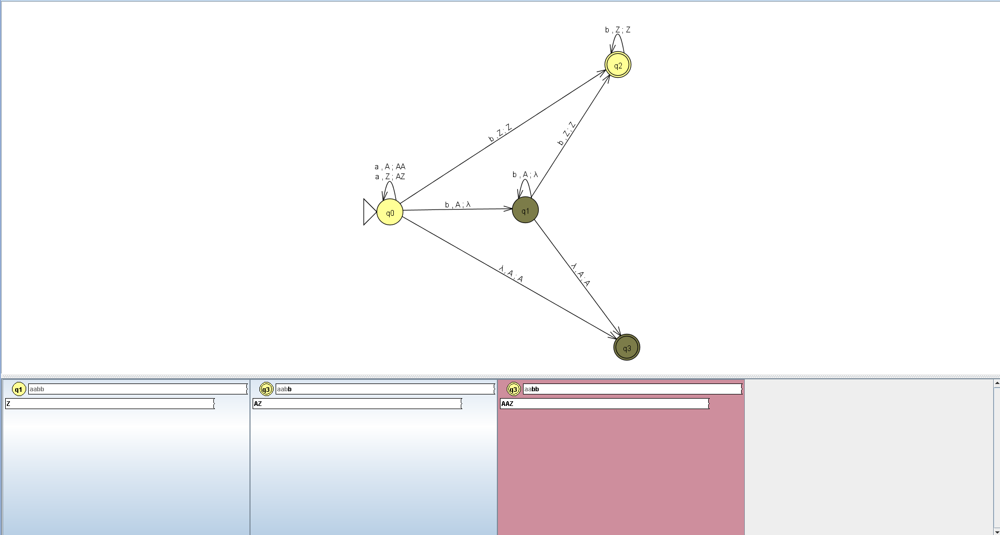
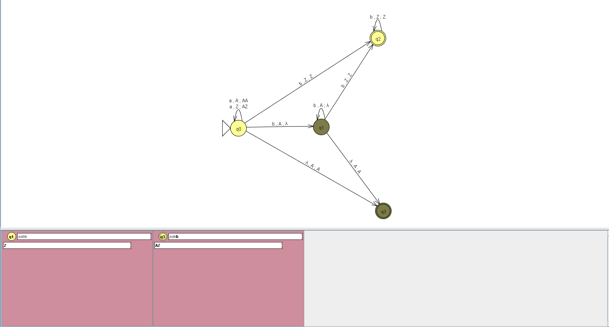

# 4. Пошаговое распознавание тестовых цепочек

Проверка автомата выполнена в JFLAP в пошаговом режиме с критерием принятия по финальному состоянию. На каждом шаге рассматривается текущее состояние автомата, непрочитанный остаток входной цепочки и содержимое магазина.

## 4.1 Допустимая цепочка `aab`

Цепочка `aab` имеет вид `a^2b^1`. Количество символов `a` равно двум, а количество символов `b` - одному. Поскольку количества не равны, цепочка принадлежит языку `L_12` и должна быть принята.

**Шаг 0.** Начальная конфигурация: автомат находится в состоянии `q0`, непрочитанная цепочка - `aab`, в магазине находится маркер `Z`.

**Шаг 1.** Прочитан первый символ `a`. Автомат остается в состоянии `q0`, в магазин добавляется символ `A`.

**Шаг 2.** Прочитан второй символ `a`. Автомат остается в состоянии `q0`, в магазине появляется еще один символ `A`.

**Шаг 3.** Прочитан символ `b`. Автомат переходит в состояние `q1` и удаляет один символ `A` из магазина. Входная цепочка прочитана полностью, но в магазине остается один символ `A`.

**Шаг 4.** Автомат использует переход с пустым входным символом и переходит в финальное состояние `q3`. В магазине остается символ `A`, что соответствует ситуации, когда символов `a` больше, чем символов `b`. Цепочка принимается.

## 4.2 Недопустимая цепочка `aabb`

Цепочка `aabb` имеет вид `a^2b^2`. Количество символов `a` равно количеству символов `b`. Следовательно, цепочка не принадлежит языку `L_12` и должна быть отклонена.

**Шаг 0.** Начальная конфигурация: автомат находится в состоянии `q0`, непрочитанная цепочка - `aabb`, в магазине находится маркер `Z`.

**Шаг 1.** Прочитан первый символ `a`. Автомат остается в состоянии `q0`, в магазин добавляется символ `A`.

**Шаг 2.** Прочитан второй символ `a`. Автомат остается в состоянии `q0`, в магазине находится два символа `A`.

**Шаг 3.** Прочитан первый символ `b`. Автомат переходит в состояние `q1` и удаляет один символ `A` из магазина.

**Шаг 4.** Прочитан второй символ `b`. Автомат остается в состоянии `q1` и удаляет оставшийся символ `A`. Вход прочитан полностью, в магазине остался маркер `Z`.

**Шаг 5.** Автомат не может перейти в финальное состояние `q3`, поскольку для перехода требуется символ `A` на вершине магазина. В состоянии `q1` также отсутствует переход, позволяющий принять цепочку с равным количеством `a` и `b`. Поэтому цепочка отклоняется.

## 4.3 Результаты проверки

| Цепочка | Результат | Обоснование |
|---|---|---|
| `aab` | Accept | Две `a` и одна `b`, количества не равны |
| `aabb` | Reject | Две `a` и две `b`, количества равны |
