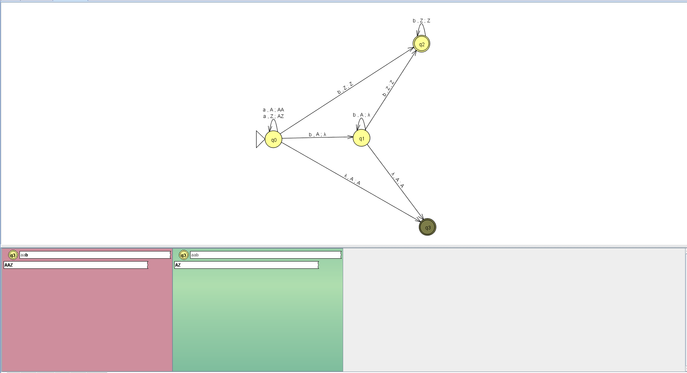

# 4. Пошаговое распознавание тестовых цепочек

Проверка автомата выполнена в JFLAP в пошаговом режиме с критерием принятия по финальному состоянию. На каждом шаге рассматривается текущее состояние автомата, непрочитанный остаток входной цепочки и содержимое магазина.

## 4.1 Допустимая цепочка `aab`

Цепочка `aab` имеет вид `a^2b^1`. Количество символов `a` равно двум, а количество символов `b` — одному. Поскольку количества не равны, цепочка принадлежит языку `L_12` и должна быть принята.

**Шаг 0.** Начальная конфигурация: автомат находится в состоянии `q0`, непрочитанная цепочка — `aab`, в магазине находится маркер `Z`.

**Шаг 1.** Прочитан первый символ `a`. Автомат остаётся в состоянии `q0`. Верхний символ `Z` заменяется последовательностью `AZ`, поэтому в магазине появляется символ `A`, а маркер `Z` сохраняется.

**Шаг 2.** Прочитан второй символ `a`. Автомат остаётся в состоянии `q0`. Верхний символ `A` заменяется последовательностью `AA`, поэтому в магазине становится два символа `A`. Одновременно доступен переход в `q3`.

**Шаг 3.** Прочитан символ `b`. Автомат переходит из `q0` в `q1`. Один символ `A` удаляется из магазина. Входная цепочка прочитана полностью, в магазине остаётся один символ `A` над маркером `Z`.

**Шаг 4.** Выполняется переход с пустым входным символом `λ` из `q1` в финальное состояние `q3`. Символ `A` остаётся в магазине, что показывает, что символов `a` было больше, чем символов `b`. Цепочка принимается.

## 4.2 Недопустимая цепочка `aabb`

Цепочка `aabb` имеет вид `a^2b^2`. Количество символов `a` равно количеству символов `b`. Следовательно, цепочка не принадлежит языку `L_12` и должна быть отклонена.

**Шаг 0.** Начальная конфигурация: автомат находится в состоянии `q0`, непрочитанная цепочка — `aabb`, в магазине находится маркер `Z`.

**Шаг 1.** Прочитан первый символ `a`. Автомат остаётся в состоянии `q0`. Верхний символ `Z` заменяется последовательностью `AZ`, поэтому в магазине появляется символ `A`, а маркер `Z` сохраняется.

**Шаг 2.** Прочитан второй символ `a`. Автомат остаётся в состоянии `q0`. Верхний символ `A` заменяется последовательностью `AA`, поэтому в магазине становится два символа `A`. Одновременно доступен переход в `q3`.

**Шаг 3.** Прочитан первый символ `b`. Автомат переходит из `q0` в `q1`. Один символ `A` удаляется из магазина. В магазине остаётся один символ `A` над маркером `Z`.

**Шаг 4.** Прочитан второй символ `b`. Автомат остаётся в состоянии `q1` и удаляет оставшийся символ `A`. Входная цепочка прочитана полностью, в магазине остался только маркер `Z`.

**Шаг 5.** Автомат не может перейти из `q1` в финальное состояние `q3`, поскольку соответствующий переход требует символ `A` на вершине магазина, а там находится `Z`. В состоянии `q1` нет подходящего перехода для принятия цепочки с равным количеством `a` и `b`. Поэтому цепочка отклоняется.

## 4.3 Результаты проверки

| Цепочка | Результат | Обоснование |
|---|---|---|
| `aab` | Accept | Две `a` и одна `b`, количества не равны |
| `aabb` | Reject | Две `a` и две `b`, количества равны |
