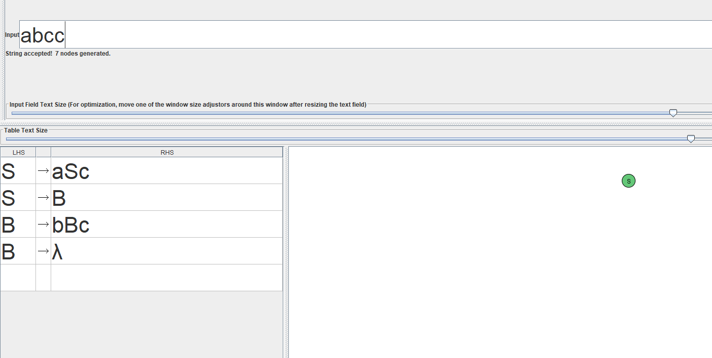
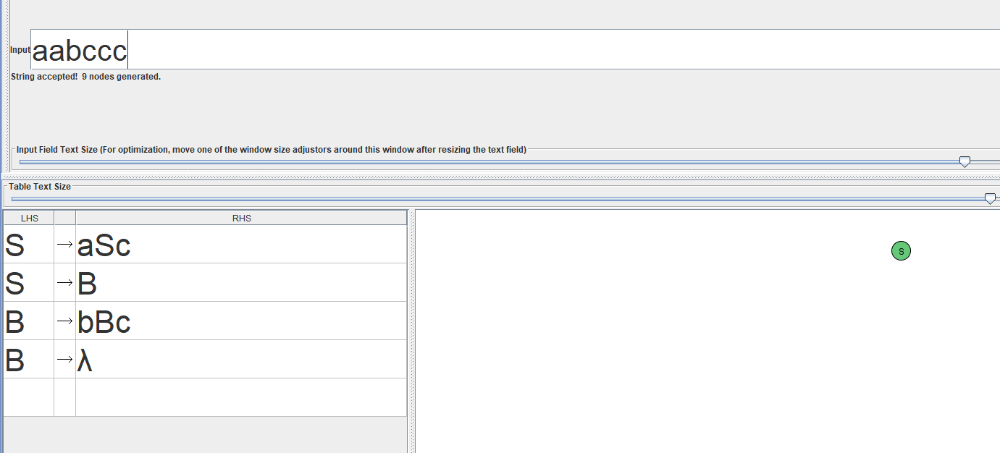
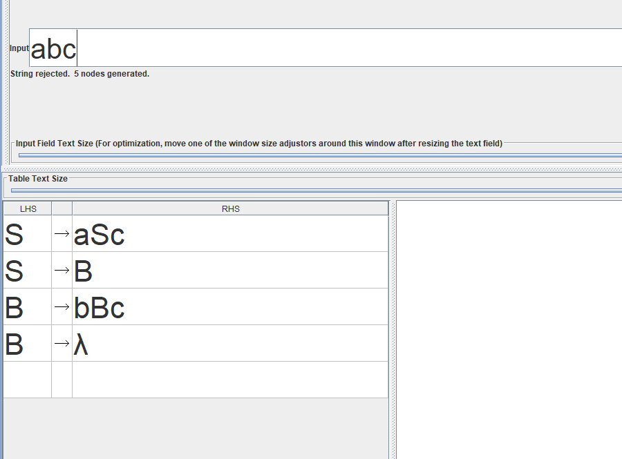
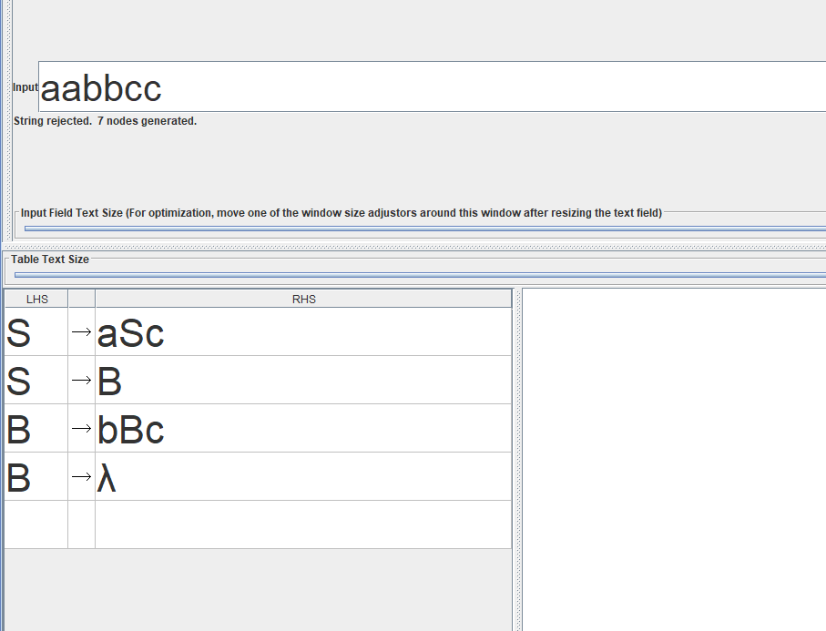

# 6. Распознавание тестовых цепочек с помощью КСГ

Для проверки грамматики использован **Brute Force Parse** в JFLAP.

## Допускаемые цепочки

Цепочки `ac`, `abcc` и `aabccc` должны приниматься, так как в них количество символов `c` равно сумме количеств символов `a` и `b` (\(k = n + m\)).

## Недопускаемые цепочки

Цепочки `abc` и `aabbcc` должны отклоняться, так как условие `(k = n + m)` для них не выполняется.

## Результаты проверки

| Цепочка | \(n\) | \(m\) | \(k\) | \(k = n + m\)? | Результат |
|---|---|---|---|---|---|
| `ε` | 0 | 0 | 0 | Да | Accept |
| `ac` | 1 | 0 | 1 | Да | Accept |
| `bc` | 0 | 1 | 1 | Да | Accept |
| `abcc` | 1 | 1 | 2 | Да | Accept |
| `aabccc` | 2 | 1 | 3 | Да | Accept |
| `abbccc` | 1 | 2 | 3 | Да | Accept |
| `abc` | 1 | 1 | 1 | Нет | Reject |
| `aabbcc` | 2 | 2 | 2 | Нет | Reject |
| `accc` | 1 | 0 | 3 | Нет | Reject |

Таким образом, результаты распознавания соответствуют условию `(k = n + m)`.
